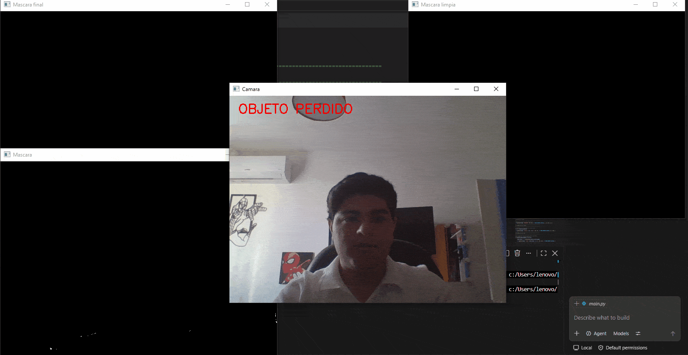

# Real-Time Object Tracker (Color + Proximity)

A real-time single-object tracker built with OpenCV that maintains object identity across frames using color segmentation combined with proximity-based matching — rather than frame-by-frame detection alone, it tracks *the same* object as it moves, and tolerates brief detection gaps without losing it.



## How it works

1. **Color segmentation** — each frame is converted to HSV and masked to isolate the target color (`cv2.inRange`), then cleaned with morphological opening and closing to remove noise and close gaps.
2. **Contour + centroid extraction** — `cv2.findContours` finds candidate regions above a minimum area threshold; `cv2.moments` computes each candidate's centroid.
3. **Initialization** — on the first valid detection, the tracker locks onto the **largest** valid candidate as the initial target.
4. **Proximity-based matching** — on every subsequent frame, each candidate's centroid is compared to the previous tracked position using Euclidean distance. The closest candidate within a maximum distance threshold (250 px) is selected as the same object — this prevents the tracker from jumping to a different object of the same color elsewhere in frame.
5. **Occlusion tolerance** — if no valid candidate is found in a frame (e.g. object briefly leaves view), the tracker holds its last known position for up to 10 consecutive frames before declaring the object lost, instead of dropping it immediately on a single bad frame.
6. **On-screen telemetry** — the live feed displays tracking status, current center coordinates, the tracked object's area, and the distance moved since the last frame.

## Tested behavior

- Tracking holds at slow, normal, and fast object movement speeds.
- With two same-color objects in frame: if both are roughly equidistant from the last known position, the tracker favors the larger one; if at different distances, it always favors the closer one.
- Occlusion handling (object briefly blocked from view) is implemented via the frame-loss tolerance described above. When that happens, the tracker remains in its last position, and the text "Lost object" appears on the screen.

## Project structure

```
├── main.py
├── requirements.txt
└── demo.gif
```

## Requirements

```bash
pip install -r requirements.txt
```

- Python 3.9+
- OpenCV (`opencv-python`)
- NumPy
- A webcam

## Usage

```bash
python main.py
```

Press `q` to exit.

## Notes

This is a lightweight, classical tracking approach — no deep learning and no OpenCV built-in trackers (CSRT/KCF/etc.) — relying entirely on color segmentation plus nearest-neighbor matching across frames. This keeps it fast and dependency-free, at the cost of being limited to single-color, single-object tracking and being sensitive to lighting conditions affecting the HSV mask.

## Author

Antonio — Graduate in Robotics & Digital Systems Engineering, UNITEC Querétaro. Working toward computer vision / ADAS roles.
